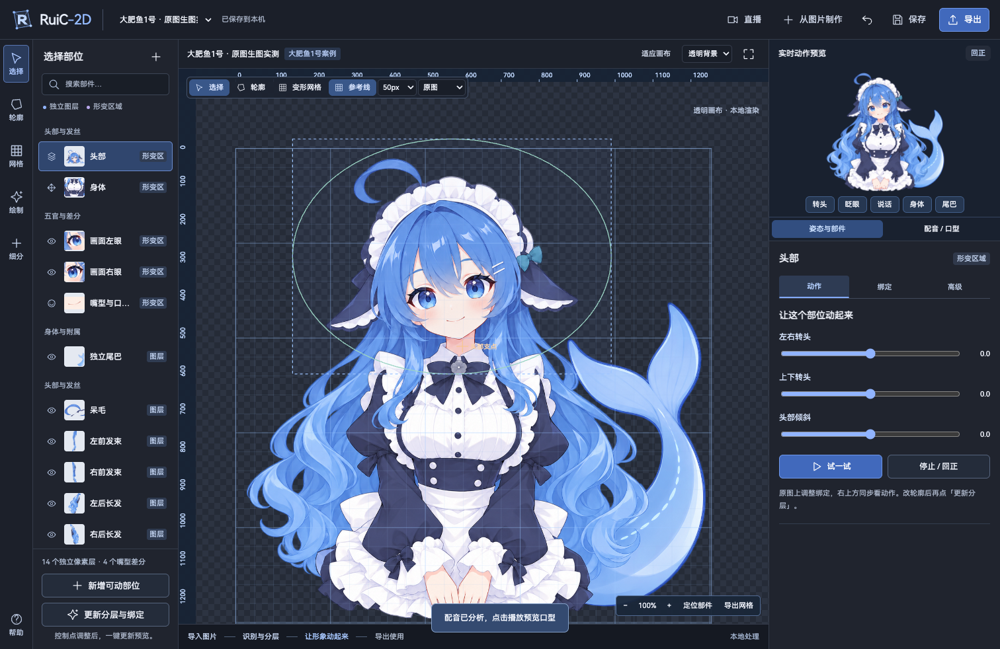
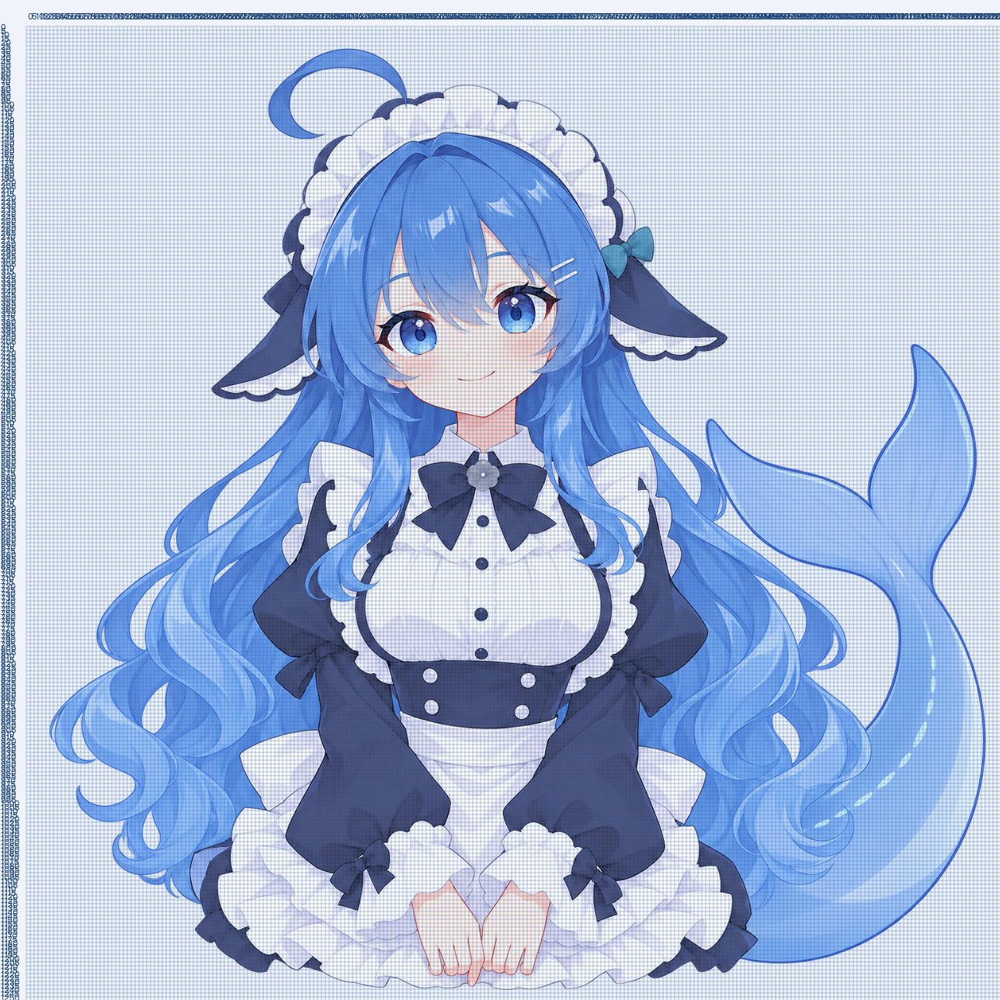

# RuiC-2D

[](LICENSE)
[](https://nodejs.org/)
[](https://www.python.org/)

从单张图片制作可动形象。本地运行的 2D 虚拟形象编辑器：分层绑定、网格形变、口型与眨眼、时间轴动效、实时面部驱动，以及 OBS 可用的透明输出。

A local-first 2D avatar editor that turns one illustration into a riggable character — layered parts, mesh deformation, lip-sync, timeline animation and live tracking, all on your own machine.



## 功能

- **单图成角色**：导入一张正面立绘，本地完成人像分割与五官分层；识别失败时可手动补点左眼、右眼和嘴巴。
- **可动部位**：头部、身体、双眼、嘴巴、尾巴、发束，以及沿轮廓新增的手、袖子等自定义部件。
- **网格绑定**：拖动眼白轮廓与切分范围，5–100px 坐标网格，滚轮缩放、Alt + 拖动平移。
- **口型与时间轴**：导入配音，用真实音量驱动口型；双击时间轴添加眨眼、身体倾斜、摆尾。
- **实时驱动**：本地 MediaPipe 面部追踪，麦克风与摄像头画面不上传；复制地址即可接入 OBS 浏览器源。
- **导出**：可重新编辑的 `.yxavatar`、兼容 Mesh Avatar 的 `.mavatar`、透明 PNG、1080 方形 30fps 透明 WebM。
- **本地优先**：服务只监听 `127.0.0.1`，不上传摄像头画面与口型音频。

## 快速开始

需要 **Node.js 20+** 与 **Python 3.10+**。

```bash
git clone https://github.com/HRuiCcc/RuiC-2D.git
cd RuiC-2D
python3 -m pip install -r requirements.txt
npm start
```

打开 <http://127.0.0.1:8796>。macOS 也可以双击 `启动RuiC-2D.command`。

- 不需要 `npm install`，前端与运行库均已随仓库提供。
- 导入配音需要系统安装 **FFmpeg**。
- AI 生图是可选能力：检测到本机已登录 [Codex CLI](https://github.com/openai/codex) 且启用 `image_generation` 时走 AI 路线，否则自动降级为本地绘制。没有配置任何 API Key。

## 让身体各部位动起来

1. 左边选择头部、身体、眼睛、嘴巴、尾巴或发束。
2. 右边直接调方向、开合、摆动幅度和周期；点击「试一试」持续预览，「停止 / 回正」结束。
3. 中间原图用于调绑定，右侧独立画布显示动作。蓝色为眼白轮廓，橙色为切分范围。
4. 修改轮廓后点击「更新分层与绑定」。普通保存也会检查是否需要重建。

新增手、袖子等可动部位：点「新增可动部位」→ 沿轮廓点击 → 命名并完成 → 点选固定端、末梢 → 拖动「手动试位置」→ 调整幅度和周期。勾选「保存为自动摆动」后保存。部件名称和移除操作在动作页的管理区域。

单张图没有提供的背面或遮挡内容不会凭空出现。大幅移动可能露出缺失区域，需要补绘。

## 网格与精细参数

支持原图、独立图层、动效视图；5/10/25/50/100px 坐标网格；滚轮缩放，Alt + 拖动平移，定位部件及网格 PNG 导出。

高级页保留头部、身体、双眼、嘴部、脸部细节、腮红、发丝、耳饰/尾巴、网格及视图参数。参数保存前校验，失败重建会恢复最后的有效工程和图层。



## 从新图制作

首页导入 PNG/JPG/WebP。最大边长 4096，工作图限制到 2048。正面人像尝试本地面部定位与人像分割，生成头发、皮肤、服装和五官层。插画识别失败时补点左眼、右眼和嘴巴三处。

人像分割不是完整的前后遮挡理解；复杂插画、道具和发束需要继续修正。界面区分独立像素层与网格形变区。

## 生图与本地补绘

左侧「绘制」先检查 Codex 登录与 `image_generation` 功能。可生成整套或单项目标。

- AI 路线使用已登录的 Codex 内置生图，原图与局部蒙版会发送到生图服务。
- 生成后统一配准，只导入目标蒙版，其余像素保持原图。
- 没有生图入口或目标未完成时，自动以本地绘制补齐闭眼、半闭眼及 A / 半 A / I / O 嘴型。
- 无生图时尾巴使用原轮廓变形或已有独立素材，不会假称补齐看不见的尾根。
- 可复制任务给当前助手，或导入外部生成的 PNG。

## 配音与实时驱动

右侧「配音 / 口型」可导入配音，以真实音量驱动口型。时间轴双击添加一次眨眼、身体倾斜或摆尾，前后回到自然状态。

顶部「直播」可开启麦克风和摄像头，校准正面并复制 OBS 地址。面部追踪使用本地 CPU，实时摄像头画面和口型音频不上传。后台使用 Worker 时钟发送动作。

## 导出

- `.yxavatar`：原图、分层、绑定、动作、配音和独立播放器，可重新编辑。
- `.mavatar`：兼容 Mesh Avatar。新增精细层合并回底图；新增独立部件动作需用 yxavatar 保留。
- PNG：当前姿态透明快照。
- WebM：1080 方形 / 30fps，带配音，透明背景保留 Alpha。目标剪辑软件的格式支持需另行确认。

角色包解压后运行 `python3 -m http.server 8080`，打开 `/player/player.html?portable=1` 独立播放。

## 示例工程：大肥鱼1号

仓库内置三个可直接打开的示例，启动后在顶部工程切换器中切换：

- `da-fei-yu-1`：原有资料迁移，增加五个独立发丝像素层。
- `da-fei-yu-1-generation-test`：原图重新生成尾巴、无尾巴身体、闭眼、半闭眼及四种嘴型，接入动作和口播。
- `da-fei-yu-1-local-test`：本地补绘眼睛和嘴型的案例。尾巴沿用既有素材，来源单独记录。

示例口播为项目自制的自我介绍（剪映「曼波讲故事」音色，1.1 倍速）。配准报告在各案例 `generated/import-report.json`。

## 目录结构

```text
server.mjs          本地 HTTP 服务、工程与导出接口
art-service.mjs     AI 生图 / 本地补绘任务调度
validation.mjs      动作参数校验
tools/              Python 分层、绑定、补绘与导出流水线
public/             编辑器、播放器、MediaPipe 运行库与品牌资源
projects/           角色工程（含三个示例，可直接打开）
qa-evidence/        自动化流程与功能验证记录
docs/               README 截图
```

## 验证与限制

功能测试记录见 [TEST-REPORT.md](TEST-REPORT.md)。摄像头与麦克风的自动化测试使用虚拟设备；实际硬件的权限、曝光、噪声和追踪观感仍需本人确认。人像分割无法补齐图片缺失的遮挡，复杂插画、道具和细发束仍需修正。WebM 已在浏览器验证播放、Alpha 与音频，其他剪辑软件尚未逐一验证。

## 开源协议

本项目代码以 **MIT License** 开源，见 [LICENSE](LICENSE)。

第三方资源与各自的许可：

| 资源 | 许可 | 说明 |
| --- | --- | --- |
| `public/vendor/mesh-avatar.js` | MIT | 基础运行时与切层代码参考 Mesh Avatar Studio，© Yuki Shindo，许可见 `public/vendor/LICENSE-mesh-avatar.txt` |
| `public/mediapipe/` | Apache-2.0 | MediaPipe 模型、JS 与 WASM，© The MediaPipe Authors，来源、版本与 SHA-256 见 `public/mediapipe/README.md` |
| `public/vendor/HarmonyOS.ttf` | HarmonyOS Sans Fonts License | © 2021 Huawei Device Co., Ltd.，仅用于界面显示；完整许可见 `public/vendor/LICENSE-HarmonyOS-Sans.txt` |
| `projects/` 中的示例角色 | 作者保留 | 「大肥鱼1号」立绘、差分与配音由项目作者提供，仅作示例随仓库分发；商用或再分发角色素材请先取得授权 |

Logo 与 `public/brand/` 下的 SVG 为本项目新绘制。
